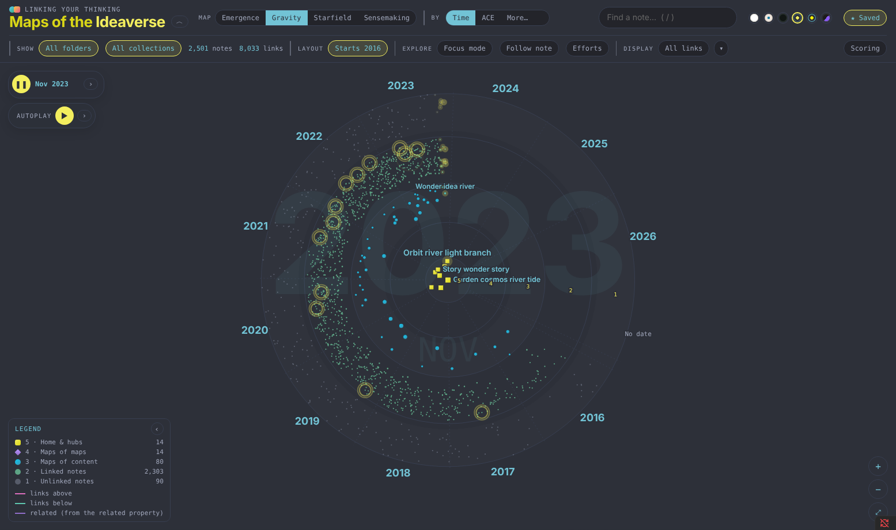

# Maps of the Ideaverse

> **Early preview (0.1).** Four maps for now (Emergence, Gravity, Starfield, Sensemaking), with more to come. Expect frequent updates and some rough edges. Issues and ideas are welcome in GitHub issues.

See your notes as maps. Every note in your vault gets a place on four maps. Three of them sort notes by how they emerged: from unlinked notes at the bottom up to your maps of maps and home notes at the top. Then press play and watch your vault grow, month by month.

Made by [Nick Milo](https://www.linkingyourthinking.com) of Linking Your Thinking, for anyone with an Obsidian vault (an "ideaverse").

Emergence in the LYT Mode theme: a map of content with links above it (pink, up to its maps and hubs) and below it (green, the notes it gathers). All screenshots use a made-up vault of 2,500 notes.

## The maps

### Emergence

Five bands, one per Idea Emergence level. Left to right is time (when each note was created), or your top folders. Click any note to light up its links: up to the maps above it, down to the notes it gathers.

### Gravity

The same levels as rings: home notes and hubs at the center, unlinked notes on the rim. Time or folders go around the clock.

Gravity by ACE folders in the Play theme: a Level 3 map and its links, from the hubs at the center to notes out on the rim.

### Starfield

Your biggest hubs become galaxy cores. Every note joins the hub it reaches in the fewest links; maps sit in the bulge, linked notes trail out along the arms, and unlinked notes drift in nebulae, one per folder. Switch to 3D to orbit it, or turn on Drift for a slow screensaver.

Starfield in 3D, Dark theme, panels tucked away. Each galaxy is a hub and the notes that reach it first.

### Sensemaking

A 2×2 of four ways of working with notes: Synthesizer (reflection, top-down), Producer (expression, top-down), Inner Guide (reflection, bottom-up) and Creative (expression, bottom-up). Each note is placed by plain rules about where it lives and how it's written (folders, maps, headings and lists, checkboxes and due dates, first-person writing, questions). No AI. Click a note to see exactly which clues moved it. Choose which years it shows under Layout.

Sensemaking in the Soft Paper theme. The panel shows why this note is a Synthesizer.

The time-lapse on Sensemaking with Swirl out: each week's new notes spiral out to where they belong.

## The time-lapse

In **Animations** (bottom left), pick **Timelapse** and press ▶ to replay your vault by month or by week. New notes arrive (popcorn, comets, rain, or a swirl), and notes move up a level as their links arrive. Click a note at any point to pause and look around; Resume carries on.

The time-lapse mid-play on Gravity, LYT Mode theme: November 2023's new notes burst in around the clock.

## How notes get their level

| Level | Name | A note lands here if… |
|---|---|---|
| 5 | Home & hubs | it's a home note, or among the top-scoring notes |
| 4 | Maps of maps | it's a map linking 3+ other maps, or it scores high |
| 3 | Maps of content | it's a map (in a Maps folder, "MOC" in its title, in a Maps collection, or mostly links), or it scores well |
| 2 | Linked notes | it has any link in or out |
| 1 | Unlinked notes | no links yet |

The score counts links in, links out, links both ways, and uplinks (the `up` and `related` properties), each with diminishing returns. A link in any other property (`topics`, `people`, `source`…) makes both notes count as linked, but doesn't add to the score. Open **Scoring** on the map to change the weights and watch notes move. Click any note to see exactly why it sits where it does.

## Using it

- Open it from the ribbon (the orbit icon) or the command **Maps of the Ideaverse: Open map**.
- Click a note to see its links; **Open note** opens it beside the map. Cmd/Ctrl-click opens it in a new tab.
- One toolbar row: the maps on the left (click the current map's tab for its variants and options; **More** holds the rest), then **Arrange** (what left to right means: Time, ACE, a number, or one of your properties), **Group** (on maps that group), **Filter** (folders and collections, with a count when it's on), **Display** (links, theme, how scoring works), **Find**, **Follow note** and **Saved**.
- Search with `/`. Drag to pan, scroll to zoom. **Focus on its links** (in a note's panel) shows one note and its neighbors. **Animations** (bottom left) holds the Timelapse, **Wander Mode** (wanders from note to linked note, or hops between maps) and **Orbit** (a slow drift; globes and 3D maps turn).
- **Follow note** (or the command **Toggle follow note**): the map follows whichever note you're editing, like a local graph linked to the active note. It works both ways: pick a note on the map (click, search, the note panel or the trail), or let a tour or Autoplay move along, and it opens in your editor, while the map keeps focus. Put the map in a split or the sidebar and it keeps up as you move through your notes. In Focus mode it shows just that note and its links.
- **★ Saved** holds saved views and tours. Name the current view (map, axis, filters, zoom and position, selected note, where the time-lapse stands, Starfield's 3D angle) to come back to it. **Record a tour**, click through some notes, stop, and name it; play it back with ‹ › or let it run. Before your first save it asks which folder to keep them in (pick one or type a new one). They live in `Maps of the Ideaverse - saved views.json` there, a plain file you own, updated every time you save. The 📁 button moves it.
- **Filter** by folder (drill into subfolders with ›) or by collection. Folder views use your top folders, whatever they're called; ACE folders (Atlas, Calendar, Efforts) get their symbols.
- **Inside a base** (Obsidian 1.10+): in any base, add a view and pick **Maps of the Ideaverse**. The map shows only the notes the base returns (one project, one book, everything tagged for a course), and updates as you change the base's filters. Levels still come from your whole vault, so a hub stays a hub. Turn on **Follow note** for a live map of the project you're working in. Each base remembers its own map settings (which map, theme, filters, Follow note) inside its `.base` file, so your project's map is set up the way you left it, and the main map tab keeps its own.
- When notes change, the map offers a rescan. Only notes that changed are read again.
- Five themes: Play, Soft Paper, Dark, LYT Mode, or match your own Obsidian theme (the last swatch), which follows it as you switch.

Focus mode on Emergence, Dark theme: one map and the 42 notes it links to, with the links among them drawn faintly.

## Settings

The first time it runs, the plugin looks for home notes (named Home, Home Base or Home Pro) and folders named Maps. In **Settings → Maps of the Ideaverse** you can also leave folders out, mark an archive folder (shown as its own layer), keep a folder hidden until you pick it, and choose how many notes reach Level 5.

Notes are dated by their `created` property (any capitalization; pick another property, or several, in Settings → Date property), or a date in the file name, or (if you leave it on) when the file was made.

## Privacy

Everything runs on your computer. The plugin reads your notes to draw the map and never changes them. It writes two files: your saved-views file, in the folder you pick, and a scan cache in the plugin's own folder (links and counts for each note, so the next scan only reads what changed; never note text). It makes no network requests and sends nothing anywhere.

## Notes

- Works on desktop, tablets and phones. On a phone the toolbar keeps to two short rows, the legend and Animations start tucked away, and tapping a note opens its panel from the bottom. Large vaults (10,000+ notes) take a while to scan the first time; after that only changed notes are read.
- Works best with folders. Vaults with few or no folders still get Emergence and Starfield; folder views will be thin.

## License

MIT
