# Maps of the Ideaverse

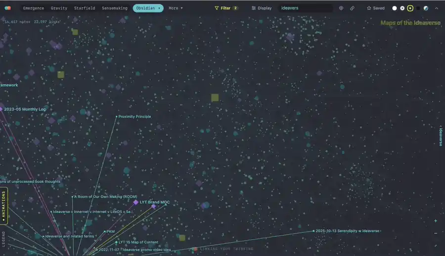
The Ideaverse map (the Obsidian map in 3D), turning through Nick Milo's own ideaverse (14,617 notes).

Visualize your notes across a suite of insanely cool interactive maps—Emergence, Ideaverse, Starfield, and many more. There is even an improved Obsidian graph, which is WAY faster. The implications of this are up to your imagination. Oh, and also, it works in Bases, which will be extremely useful for anyone, especially researchers, who use targeted datasets. Data visualization has become reborn.

See your notes as maps. Every note in your vault gets a place, by what it is and how it's linked: from unlinked notes at the bottom up to your maps of maps and home notes at the top. Press play and watch your vault grow, month by month. Then try it another dozen ways: as rings, as galaxies, as a graph, as a bookshelf, as a wall of movie posters.

Made by [Nick Milo](https://www.linkingyourthinking.com) of Linking Your Thinking, for anyone with an Obsidian vault (an "ideaverse"). Free, open source, and it never changes your notes.

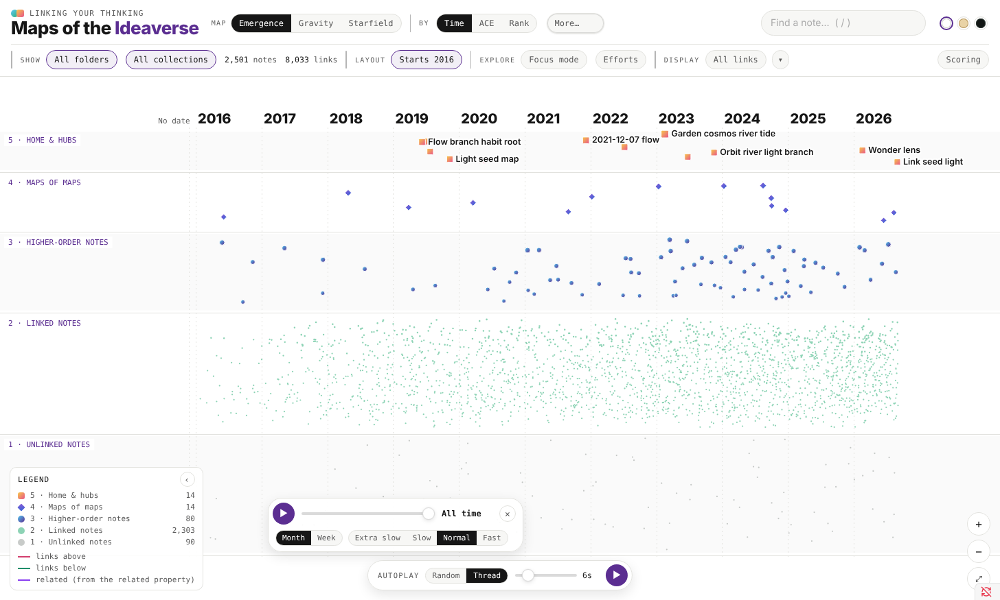
Emergence in the LYT Mode theme: a map of content with links above it (up to its maps and hubs) and below it (the notes it gathers). The other screenshots use a made-up vault of 2,500 notes and 160 made-up films.

## The maps

Four main maps sit in the toolbar: Emergence, Ideaverse, Starfield and Sensemakers. Click a map's tab again for its variants and options. **More** holds the rest, starting with Gravity. On wide windows, **Display → Show more map names** lists eight more maps in small type beside the tabs.

### Emergence

Five bands, one per Idea Emergence level. Left to right is time (when each note was created), or your top folders. **Filter** sets the **years shown**: drag either end to keep only, say, 2022 to 2024 (every map of the whole vault shares it: Gravity, Starfield, Sensemakers, Obsidian, Chord, Treemap, Mosaic and the rest; Posters and People have their own sliders). Notes from other years and notes with no date wait in No date, Before and After strips at the edges; turn off **Show notes outside the date range** to leave them off the map. Click any note to light up its links: up to the maps above it, down to the notes it gathers. Its menu also has **Space-Time** (your top folders as rows) and **Planetarium** (stand inside it: Level 5 overhead).

### Ideaverse

Your whole vault as a ball of notes in 3D: every note pushes the others away and its links pull it toward its neighbors, drawn with the emergence symbols so hubs and maps stand out. Drag to turn it, scroll to fly in, and let Orbit (in Animations) turn it slowly, like the Earth, or Mercury. It's the animation at the top of this page.

### Gravity (More)

The same levels as rings: home notes and hubs at the center, unlinked notes on the rim. Time or folders go around the circle.

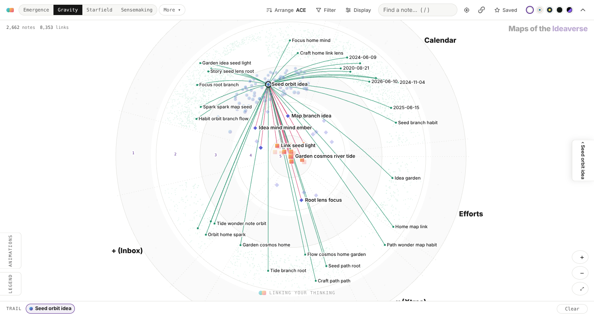
Gravity by ACE folders in the Play theme: a Level 3 map and its links, from the hubs at the center to notes out on the rim.

### Starfield

Your biggest hubs become galaxy cores. Every note joins the hub it reaches in the fewest links; maps sit in the bulge, linked notes trail out along the arms, and unlinked notes drift in nebulae, one per folder. Click a galaxy's name to fly into it. Starfield's own menu switches to 3D and sets the galaxy glow, a very occasional twinkle, and galaxies that slowly turn. On the Timelapse, each new note flares as it's born. Orbit (in Animations) makes it a slow screensaver.

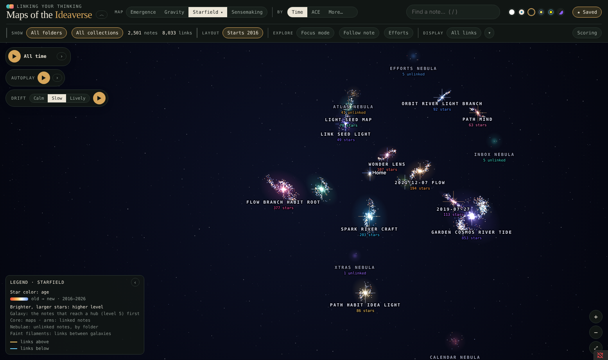
Starfield in 3D, Dark theme. Each galaxy is a hub and the notes that reach it first.

### Sensemakers

A 2×2 of four ways of working with notes: Synthesizer (reflection, top-down), Producer (expression, top-down), Inner Guide (reflection, bottom-up) and Creative (expression, bottom-up). Each note is placed by plain rules about where it lives and how it's written (folders, maps, headings and lists, checkboxes and due dates, first-person writing, questions). No AI. Click a note to see exactly which clues moved it.

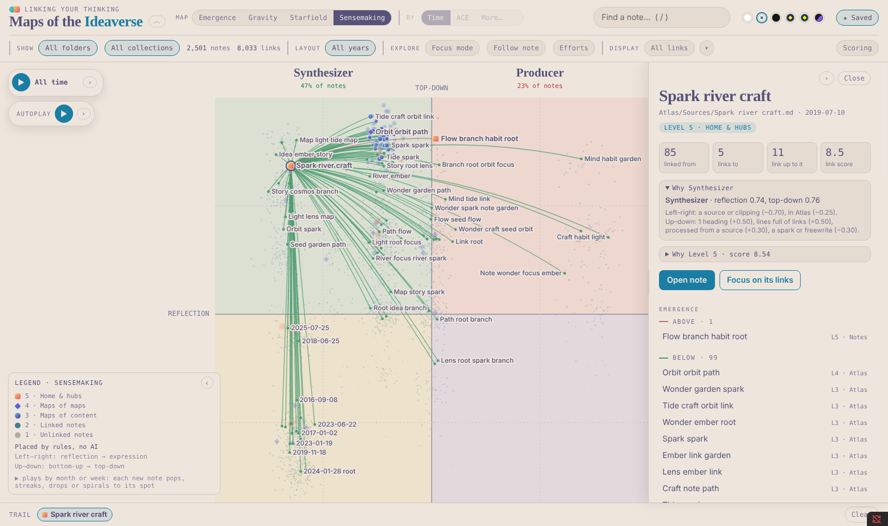
Sensemakers in the Soft Paper theme. The panel shows why this note is a Synthesizer.

## More maps

**More** holds the rest.

### Obsidian

Our take on Obsidian's graph view: every note pushes the others away and its links pull it toward its neighbors, settling live as you watch. Drag a note and its links tug the rest along; let go and it settles. Drawn with the emergence symbols, so hubs and maps stand out, and with everything the other maps have: the Timelapse, Wander Mode, Focus mode, filters. Unlinked notes ring the outside. Its menu has the forces, as in Obsidian's graph settings: **Gravity** (the pull to the middle; lower it to let a big graph spread out), **Repel** and **Link length**. The graph moves as you drag.

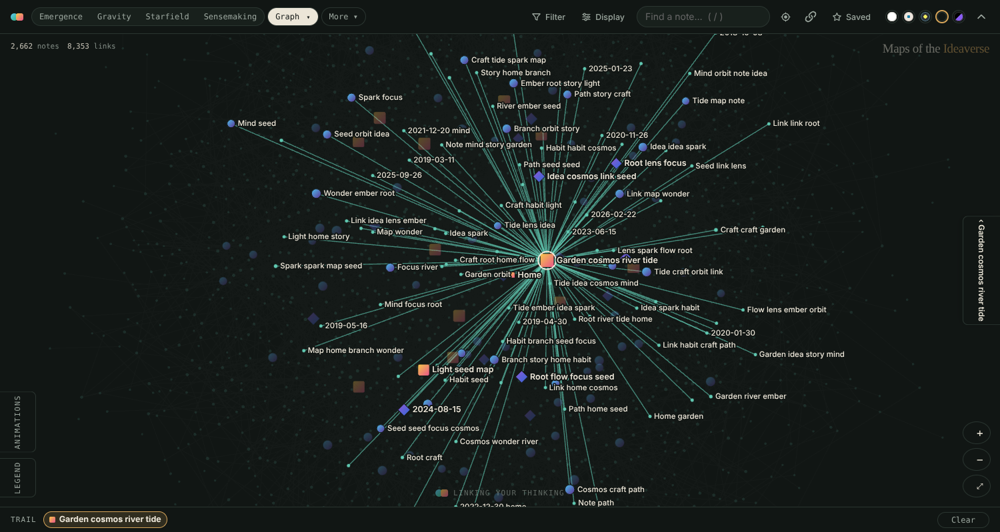
The Obsidian map in the Dark theme, zoomed in on a hub and its links.

### Tesla, Chord and Corona (More)

Every note on a ring, in arcs by folder, by year, or by first-level tag. Links between kinds cross the middle as bands that thicken as your vault grows. Hover an arc to light up where its links go. **Corona** puts the ring on a globe and arcs the links over the surface like solar prominences; **Tesla** sends them through a glass globe.

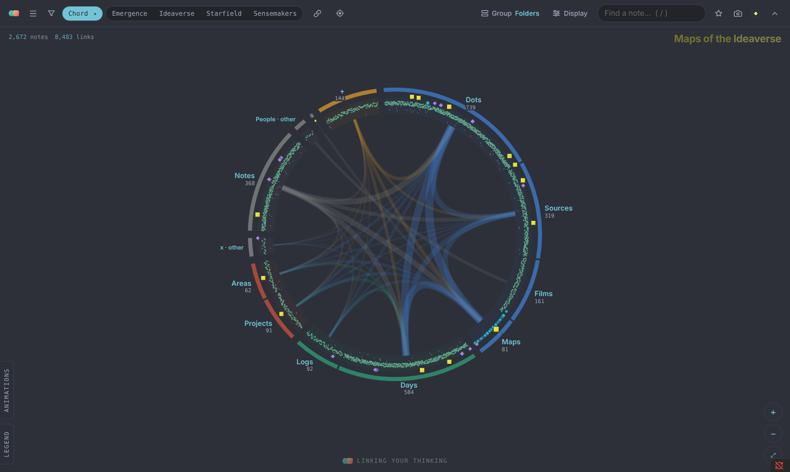
Chord in LYT Mode: each arc a folder, each band the links between two of them.

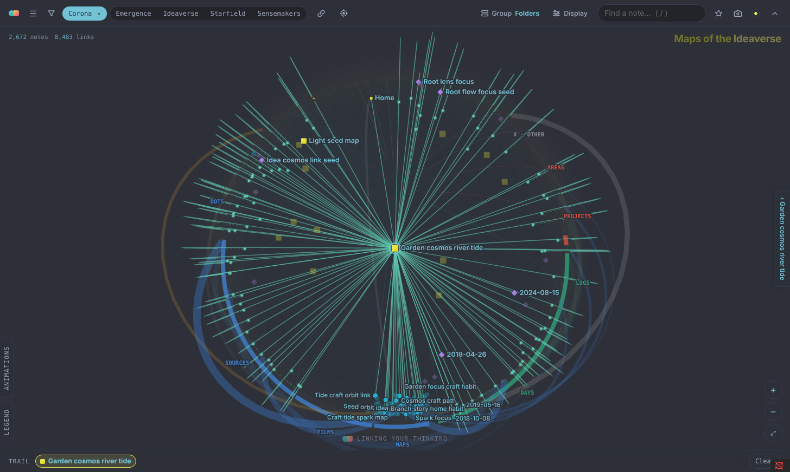
Corona in the Dark theme, with one hub's links arcing over the globe.

### Treemap

Every folder and note as a rectangle, sized by its score. Subfolders can be outlined and named. Switch its menu to **Tags** and the boxes become your tags instead: a box per first-level tag, a box per nested tag inside it. Every tag has a chip to switch it off or on (with All and None), so you can keep just one family of tags, say `#garden`, and see it laid out.

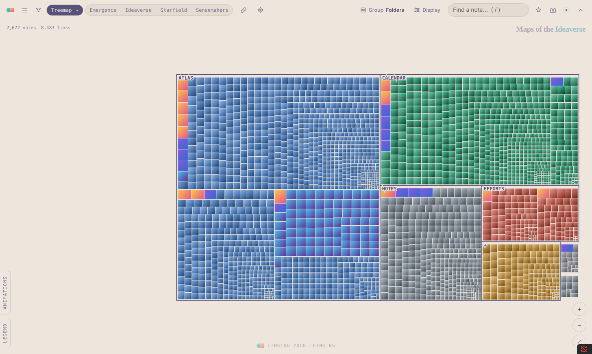
Treemap in Soft Paper.

### Mosaic

Every note a tile, set like stones. **Emergence** puts your Level 5 notes at the heart and each level in a square frame around the one above it, out to the unlinked notes at the edge; inside a frame, a folder's notes sit together as a patch of color. **Scattered** lays the same tiles like a brick wall, in no order. A tile's size comes from its link score, and maps and hubs wear their level colors.

### Tree (under Experimental)

Home is the trunk; every note hangs from the path it reaches Home by in the fewest links. Click any leaf to light its way home, branch by branch, with how many links it takes: degrees of separation for your notes.

### Bookshelf

Every note as a book on a double-wide shelf, shelved by call number (a decimal system that comes from your own linking), title, date, subfolder or tag. By tag, each first-level tag is a bookcase and its second level a labelled run (a note goes under its first tag that's switched on), for vaults that use tags instead of folders. Treemap, Bookshelf and Chord share one set of tag chips in their menus, to switch tags off and on. An Index panel lists every call number, ready to copy as a Markdown list.

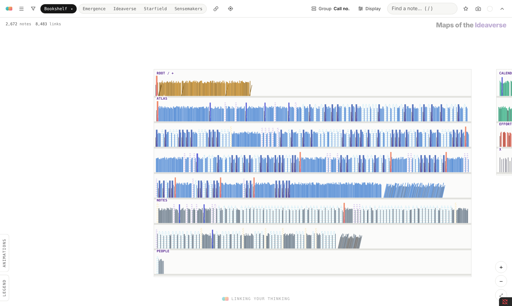
Bookshelf in the Play theme, shelved by call number.

### Base Builder (More)

For any base: the notes it returns, laid out by the base's own columns. Its first guesses come from the base. Left to right is the first date or number column, rows are the base's groups (or its first category column), and size is the next number column. A line in its menu says what it picked, and every choice can be changed there, with a mini slider for each. Pick a second number for Bottom to top and the rows become a scatter, or switch to Mosaic, or to Constellation: the people the base's columns name (director, cast, author) as stars, joined by the notes they share. Constellation's own options pick which properties make the stars and how many people show. When a property holds a span of years (a lifespan like `1879 – 1955`), **Timeline** draws each note as a thin bar from start to end, the earliest at the lower left and the latest at the upper right; an open end (still alive) fades toward today. Notes with a picture property show as cards; the rest are dots, colored by their row. A base opens on Base Builder until you pick another map, and it remembers its settings in the .base file.

### Posters (More → Experimental → Specialized)

For a smaller, targeted set: a collection, a folder, or a base view (your movies, your books, a learning pack). Each note becomes a card, laid out by its own properties, and if notes have an image property (a poster, a cover, a link to an image in your vault), the card shows it. Click the Posters tab for its menu:

- **Layout:** **Rows** (one row per value of a category, like genre or status), **Scatter** (two numbers, one left to right and one bottom to top), or **Mosaic** (every card as a tile, no gaps, a block per category).
- **Left to right** (a date or number), **Rows by** (a category) or **Bottom to top** (a second number), and **Card size** (a number). A line under each says what it takes.
- Under each, a mini slider: a little histogram of that property's values, with two handles that keep only the notes in between (just the '90s, only your 4-star films). Rows get chips instead, one per value with its count: click to switch one off, ⌥/⌘-click to show only that one.

The map picks sensible defaults from the properties your notes share. Inside a base it follows the base: its Sort sets left to right and its Group sets the rows.

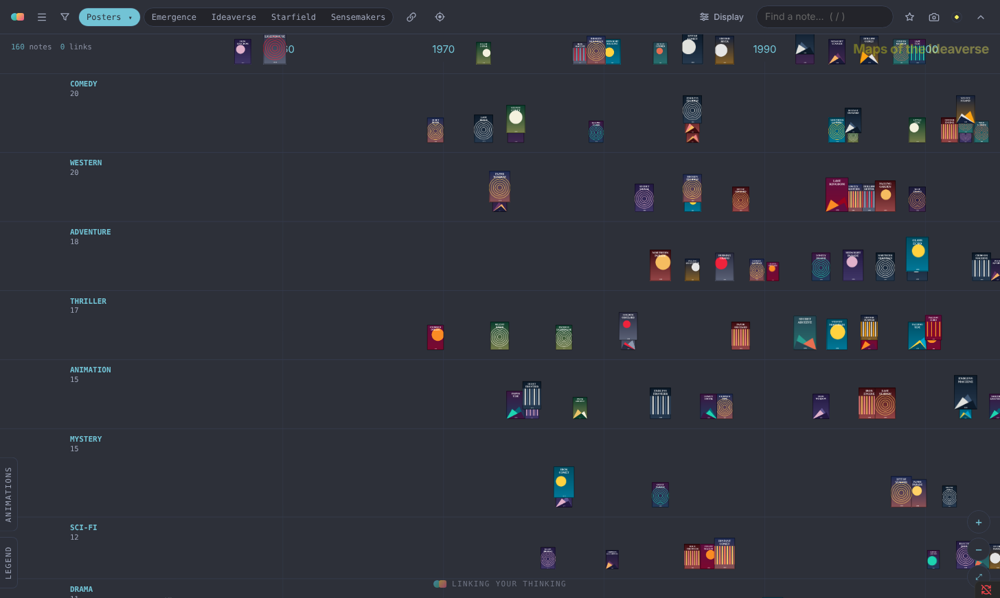
Posters in the Dark theme: made-up films by release year, a row per genre, sized by rating.

In **Scatter**, when the two numbers are the same kind of thing (two ratings, two years), a line marks where they agree, and the notes furthest from it get a ring: your rating against the crowd's shows your hidden gems above the line.

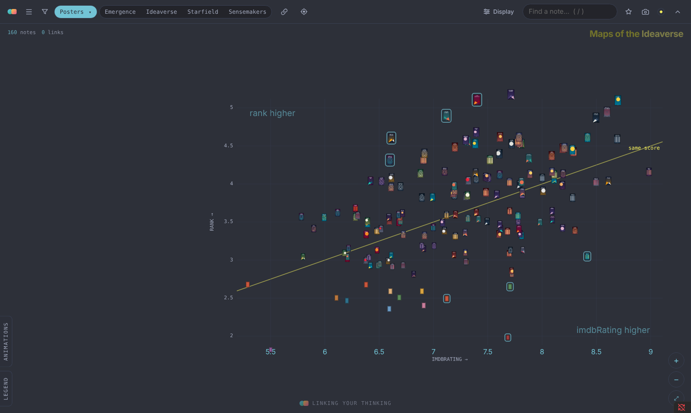
Scatter: IMDb rating left to right, your own rating bottom to top, and the "same score" line.

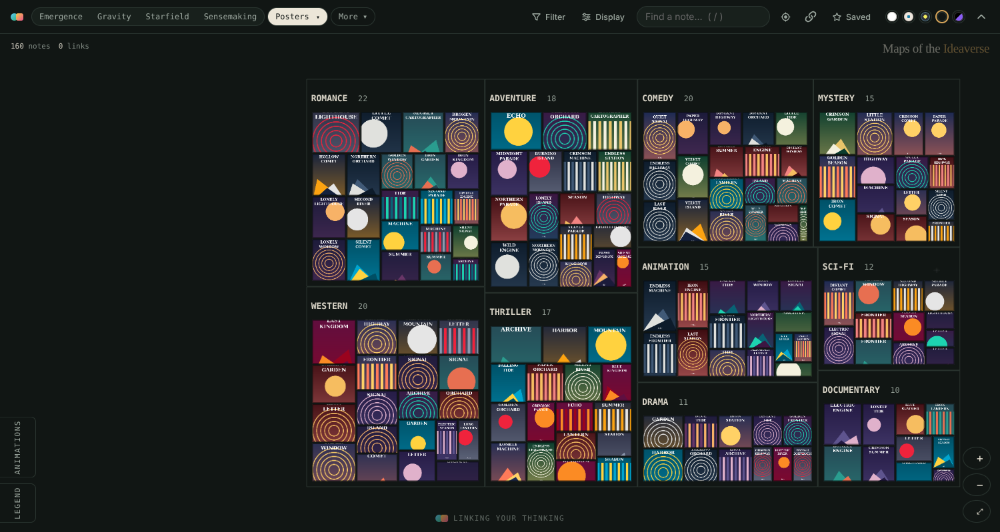
Mosaic: every film a tile, a block per genre, each tile sized by your rating.

### People (More → Experimental → Specialized)

The people your notes name, in properties like director, actors, author or guests, become stars, sized by how many notes name them. Lines join people who share notes (a director and the actors they keep casting), brighter the more they share. Each note orbits its main person, on the side facing the others it names; zoom in to see pictures. A person needs no note of their own; if they have one, it sits at their star. Click any star, even a person with no note, to light up their notes and the people they share them with. In Focus mode, one step shows a note and its people; two steps adds the other notes those people share. Click the People tab to choose which properties count and how many people to show.

### Experimental

Sketches still taking shape: **Geometric** (your top 25 notes placed by triangles: Square, Hexagon, Mandala, Octahedron, Shells), **Linear** (Linear Calendar, Spiral, Lifeline), **Planet** (the PKM Planet map: Flat, Tabletop, Globe) and **Unfinished** (Tree, Skyline).

## The time-lapse

In **Animations** (bottom left), pick **Timelapse** and press ▶ to replay your vault by month or by week. New notes arrive (comets, rain, or a swirl), and notes move up a level as their links arrive. Click a note at any point to pause and look around; Resume carries on.

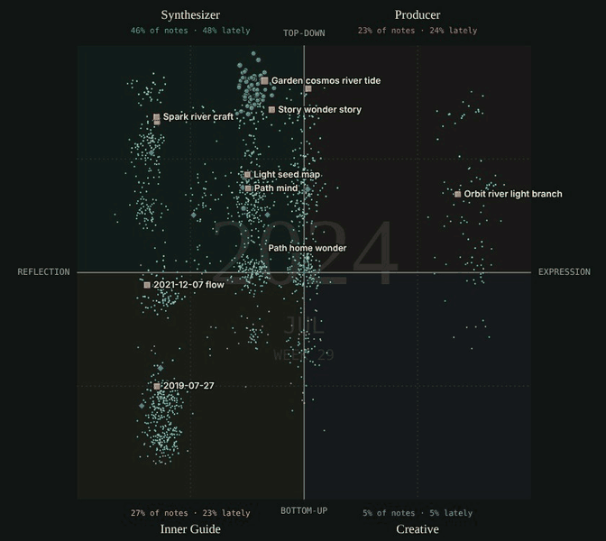
The time-lapse on Sensemakers with Swirl out: each week's new notes spiral out to where they belong.

## How notes get their level

| Level | Name | A note lands here if… |
|---|---|---|
| 5 | Home & hubs | it's a home note, or among the top-scoring notes |
| 4 | Maps of maps | it's a map linking 3+ other maps, or it scores high |
| 3 | Maps of content | it's a map (in a Maps folder, "MOC" in its title, in a Maps collection, or mostly links), or it scores well |
| 2 | Linked notes | it has any link in or out |
| 1 | Unlinked notes | no links yet |

The score counts links in, links out, links both ways, and uplinks (the `up` and `related` properties), each with diminishing returns. A link in any other property (`topics`, `people`, `source`…) makes both notes count as linked, but doesn't add to the score. Open **Scoring** on the map to change the weights and watch notes move. Click any note to see exactly why it sits where it does.

## Using it

- Open it from the ribbon (the orbit icon) or the command **Maps of the Ideaverse: Open map**.
- Click a note to see its links; **Open note** opens it beside the map. Cmd/Ctrl-click opens it in a new tab.
- One toolbar row: the maps on the left (click the current map's tab for its variants and options; **More** holds the rest), then **Arrange** (how notes are placed: left to right on Emergence (Planetarium too), around the circle on Gravity, the stars' color on Starfield; by Time, ACE, a number, or one of your properties), **Group** (on maps that group), **Filter** (folders and collections, with a count when it's on), **Display** (Show all links, and how notes are scored), **Find**, **Focus on active note** (the note and its neighbors), **Sync active note with Obsidian editor** and **Saved**. The note and link counts sit at the map's top left.
- **Display → Show the way home** (Kevin Bacon): on any map, the note you're on lights up the fewest links back to Home, naming each note on the way and counting the steps. To head somewhere else, click the note's name there and search for any note, or click a note on the map and choose **Use this note**; **Default** switches back. The default is your first home note, or the note named in Settings → Show the way home. A mini switch turns the straight lines slightly curved.
- Search with `/`. Drag to pan, scroll to zoom. **Focus** (the toolbar's target icon, or **Focus on its links** in a note's panel) shows one note and its neighbors. **Animations** (bottom left) holds the Timelapse, **Wander Mode** (wanders from note to linked note, or hops between maps) and **Orbit** (a slow drift; globes and 3D maps turn).
- **Sync active note with Obsidian editor** (the toolbar's sync icon, or the command **Toggle follow note**): the map follows whichever note you're editing, like a local graph linked to the active note. It works both ways: pick a note on the map (click, search, the note panel or the trail), or let a tour or Autoplay move along, and it opens in your editor, while the map keeps focus. Put the map in a split or the sidebar and it keeps up as you move through your notes. In Focus mode it shows just that note and its links.
- **★ Saved** holds saved views and tours. Name the current view (map, axis, filters, zoom and position, selected note, where the time-lapse stands, Starfield's 3D angle) to come back to it. **Record a tour**, click through some notes, stop, and name it; play it back with ‹ › or let it run. Before your first save it asks which folder to keep them in (pick one or type a new one). They live in `Maps of the Ideaverse - saved views.json` there, a plain file you own, updated every time you save. The 📁 button moves it.
- **Filter** by years, folder (drill into subfolders with ›) or collection; the folder and collection lists sit side by side, every choice in view. Folder views use your top folders, whatever they're called; ACE folders (Atlas, Calendar, Efforts) get their symbols.
- **Inside a base** (Obsidian 1.10+): in any base, add a view and pick **Maps of the Ideaverse**. The map shows only the notes the base returns (one project, one book, everything tagged for a course), and updates as you change the base's filters. Levels still come from your whole vault, so a hub stays a hub. Turn on **Follow note** for a live map of the project you're working in. Each base remembers its own map settings (which map, theme, filters, Follow note) inside its `.base` file, so your project's map is set up the way you left it, and the main map tab keeps its own.
- When notes change, the map offers a rescan. Only notes that changed are read again.
- Five themes: Play, Soft Paper, Dark, LYT Mode, or match your own Obsidian theme (the last swatch), which follows it as you switch.

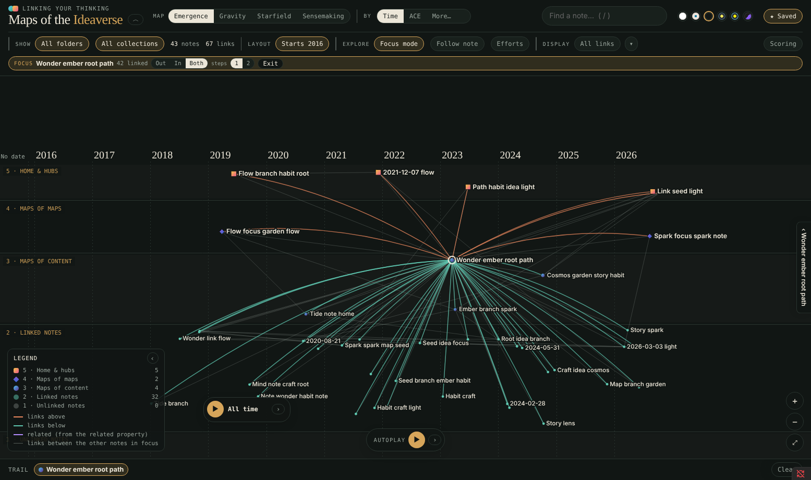
Focus mode on Emergence, Dark theme: one map and the 36 notes it links to, with the links among them drawn faintly.

## Settings

The first time it runs, the plugin looks for home notes (named Home, Home Base or Home Pro) and folders named Maps. In **Settings → Maps of the Ideaverse** you can also leave folders out, mark an archive folder (shown as its own layer), keep a folder hidden until you pick it, and choose how many notes reach Level 5.

Notes are dated by their `created` property (any capitalization; `createdAt`, `date created`, `date` and similar names work too, and you can add your own or reorder them in Settings → Date property; the first one a note has wins), or a date in the file name, or (if you leave it on) when the file was made. A month or year alone (`2024-05`, `2024`) counts as its first day. If your files' dates come from git checkouts or a sync, turn off Dates from files and point at your own property instead.

If your vault names its properties differently (`collection` instead of `collections`, `parent` instead of `up`), set them in Settings → Property names: Up, Related, Collections and Rank each take a comma-separated list, in any capitalization.

Links are `[[wikilinks]]`. If your vault also has markdown links to notes (`[text](folder/Note.md)`, often written by tools), turn on Settings → Markdown links.

## Privacy

Everything runs on your computer. The plugin reads your notes to draw the map and never changes them. It writes two files: your saved-views file, in the folder you pick, and a scan cache in the plugin's own folder (links and counts for each note, so the next scan only reads what changed; never note text). It sends nothing anywhere. The one exception: in the Posters map, if a note's image property is a web address (a movie poster URL, say), the map loads that picture from the web to show it, the same way Obsidian shows it in a note. Pictures from your vault load locally.

## Notes

- Works on desktop, tablets and phones. On a phone the toolbar keeps to two short rows, the legend and Animations start tucked away, and tapping a note opens its panel from the bottom. Large vaults (10,000+ notes) take a while to scan the first time; after that only changed notes are read.
- Works best with folders. Vaults with few or no folders still get Emergence and Starfield; folder views will be thin.

## License

MIT
